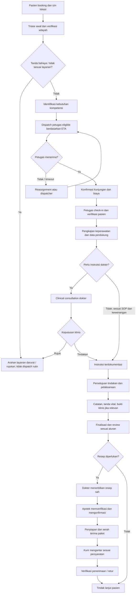

# MADISING
## Product Requirements Document (PRD) — V1.3.6
**Status:** Draft implementasi; **MODEL-A / VENDOR-MAINTENANCE LOCKED**; **Nama resmi MADISING menggantikan identitas lama;** **aturan enam dashboard, kontrol akses, dan wilayah pilot Sidrap, serta rekrutmen dan provisioning akun klinis berstatus DIKUNCI**  
**Tanggal:** 5 November 2026  
**Model bisnis:** Satu perusahaan penyedia layanan homecare dengan fasilitas, tenaga kesehatan, RME, dan mitra apotek/kurir yang menurut pemilik sudah tersedia.  
**Platform target:** Aplikasi pasien Android + iOS; aplikasi petugas Android + iOS; web dokter, admin, apotek; portal kurir/PWA atau API mitra.  
**Amendemen V1.3.4 (IDENTITY-LOCK):** Seluruh identitas proyek dan aplikasi diubah menjadi **MADISING**. Nama lama tidak digunakan untuk pengembangan baru. Perubahan ini hanya menyangkut brand/label/identitas contoh; seluruh ketentuan fitur, kewenangan klinis, enam dashboard, SIDRAP-LOCK dan STAFF-LOCK tetap berlaku. Nomor kode data contoh diperbarui menjadi `MDS-*`. Integrasi produksi belum terhubung.
**Amendemen V1.3.5 (GOVERNANCE-LOCK):** Model A diputuskan: Owner dapat sekaligus menjalankan tugas Admin; Vendor merupakan identitas teknis tersendiri, dengan akun Admin operasional hanya jika ditunjuk secara eksplisit. **Kewenangan maintenance vendor bersifat WAJIB DISEDIAKAN**, termasuk monitoring, diagnosis bug, perbaikan, pembaruan, deployment terkontrol, backup/restore terotorisasi, dan pengujian integrasi. Tidak berarti vendor memperoleh akses bebas ke rekam medis, foto tindakan, resep, dan data pasien produksi. Ketentuan rinci tercantum dalam bagian **3.4** dan **12A**.
**Catatan:** PRD ini merupakan spesifikasi produk, bukan konfirmasi verifikasi legalitas, kepatuhan, atau konektivitas mitra. Prototipe yang menyertai PRD menggunakan data simulasi dan tidak menyimpan rekam medis nyata. **Riwayat V1.3.3: STAFF-LOCK — rekrutmen tertutup, verifikasi STR/SIP/kredensial, persetujuan Owner, dan akun klinis hanya dibuat Admin. Keputusan sebelumnya tetap berlaku.**

---

**Amendemen V1.3.6 (ACCOUNT-LOCK / ROLE-LOCK):** Akun pasien dan kurir dibuat melalui registrasi mandiri dengan verifikasi; akun dokter, perawat, dan apotek hanya di-*provision* oleh Admin (tidak ada *sign-up* publik); Owner dapat merangkap Admin dengan kewenangan yang tercatat terpisah; Vendor tetap pada Developer Console teknis dengan kewenangan maintenance V1.3.5. Dashboard utama tetap **enam**, dan seluruh pengguna hanya boleh menggunakan resource serta tindakan yang diizinkan untuk peran dan penugasannya. Lihat bagian **2C**.

## 1. Ringkasan produk

MADISING adalah ekosistem pelayanan kesehatan di rumah yang menghubungkan permintaan pasien, triase awal, pencocokan tenaga kesehatan berdasarkan wilayah dan kompetensi, kunjungan lapangan, konsultasi dokter, instruksi tindakan, pencatatan dan dokumentasi klinis, resep sah, pemenuhan oleh apotek berizin, dan pengantaran obat oleh kurir yang memenuhi persyaratan.

**Prinsip operasional:** keputusan diagnosis medis dan resep oleh dokter berwenang; pengkajian dan tindakan keperawatan oleh perawat sesuai kewenangan; verifikasi/penyiapan/penyerahan obat oleh apotek berizin; kurir hanya menerima informasi logistik minimal; admin tidak bebas mengakses rekam medis.

### 1.1 Sasaran
1. Pasien dapat mengajukan kunjungan tanpa menghubungi beberapa pihak terpisah.
2. Penugasan petugas dapat dilakukan dengan aturan *eligibility first, ETA second*.
3. Seluruh kunjungan memiliki jejak audit, persetujuan, instruksi yang relevan, catatan tindakan, serta dokumentasi yang diperlukan.
4. Resep, pesanan apotek, dan pengantaran berada dalam satu garis waktu operasional, tanpa membagikan data medis berlebihan.
5. Dokter/koordinator dapat mengawasi kualitas klinis; manajemen memantau SLA dan keuangan dengan akses sesuai peran.
6. Sistem terintegrasi dengan RME yang telah tersedia; menghindari dua sumber kebenaran klinis.

### 1.2 Bukan sasaran V1
- Mengganti sistem RME yang telah berjalan tanpa audit integrasi.
- Mendiagnosis penyakit secara otomatis atau mengizinkan perawat mendiagnosis medis/meresepkan di luar kewenangan.
- Menjual obat sendiri tanpa penetapan model usaha/perizinan terpisah.
- Marketplace terbuka untuk tenaga kesehatan/apotek/kurir yang belum diverifikasi.
- Layanan gawat darurat dengan janji respons setara ambulans/IGD.
- Menggunakan geolokasi tanpa izin atau melacak lokasi pasien terus-menerus.

## 2. Asumsi yang dikonfirmasi dan keputusan tertunda

**Dinyatakan telah tersedia oleh pemilik:** basis fasilitas pelayanan, dokter/tenaga kesehatan berizin, RME, peralatan dan SOP, kerja sama apotek, kerja sama kurir. Status dokumen dan rincian teknis API belum diuji.

| Keputusan | Status pada PRD | Tindak lanjut go-live |
|---|---|---|
| Entitas penyelenggara klinis | Fasilitas milik/mitra yang menyelenggarakan MADISING | Identitas, izin, cakupan layanan diverifikasi dokter |
| RME existing | Integrasi-adapter, bukan duplikasi | Vendor/format API, mapping pasien, modul SATUSEHAT |
| Jenis layanan | Katalog berbasis konfigurasi, hanya yang diaktifkan | Dokter menyetujui lingkup tiap tindakan |
| Apotek mitra | Portal mitra + adapter API bila tersedia | SLA, legalitas, metode resep/pesanan, stok/harga |
| Kurir | Portal mitra + adapter API bila tersedia | Area, SLA, rantai penguasaan, obat khusus/suhu |
| Pembayaran | Pisah pembayaran layanan dan obat | Merchant of record, biaya pengiriman, refund/dispute |
| Tracking petugas | Hanya sepanjang penugasan aktif dan disetujui | Kebijakan privasi/retensi dan transparansi pengguna |
| Lokasi server | Dipilih pada tahap infrastruktur | Kajian keamanan, residensi data, kontrak pemrosesan |

## 2A. KEPUTUSAN DIKUNCI — Wilayah Operasional Prototipe (SIDRAP-LOCK)

**Status: LOCKED / WAJIB.** Pada V1.3.2 dan seluruh prototipe yang berlaku, layanan MADISING hanya dapat dipesan untuk alamat tujuan **di dalam wilayah administratif Kabupaten Sidenreng Rappang (Sidrap), Provinsi Sulawesi Selatan**. Wilayah ini bukan lokasi HP saat booking, melainkan **lokasi pasien yang akan dikunjungi**. Pasien boleh memesan dari kota lain untuk anggota keluarga, selama alamat kunjungan berada di Sidrap dan memiliki hak pemesanan yang sah.

**Kecamatan dalam batas administratif prototipe (11):** Maritengngae; Panca Rijang; Baranti; Kulo; Watang Pulu; Panca Lautang; Tellu Limpoe; Watang Sidenreng; Dua Pitue; Pitu Riawa; Pitu Riase.

Rujukan administratif: Pemerintah Kabupaten Sidenreng Rappang, Profil Letak, Luas dan Batas Wilayah (11 November 2024), https://sidrapkab.go.id/profil/detail/Profil185843-LETAK%2C-LUAS-DAN-BATAS-WILAYAH ; dan aplikasi resmi SmartGIS Bapenda Sidrap https://smartgis.sidrapkab.go.id/ .

### 2A.1 Matriks aturan

| ID | Aturan wajib | Kriteria penerimaan |
|---|---|---|
| GEO-01 | Cakupan pilot tunggal: Kabupaten Sidrap. | Konfigurasi `service_area=SIDRAP_PILOT`, `regency_code` sesuai master wilayah yang tervalidasi, `enabled=true`; kabupaten lain tidak aktif. |
| GEO-02 | Validasi berdasarkan alamat **tujuan kunjungan**, bukan lokasi pengguna yang memesan. | Pengguna dari luar Sidrap dapat mendaftarkan pasien di Sidrap; kunjungan di luar Sidrap ditolak. |
| GEO-03 | Pasien dapat memilih pin GPS atau mengisi alamat manual. | Izin lokasi diminta secara eksplisit. Tidak ada paksaan GPS; pemilihan kabupaten/kecamatan dapat manual. |
| GEO-04 | Geofence produksi menggunakan poligon administratif resmi; bukan bounding box, kode pos, nama kota dalam teks bebas, atau radius dari pusat kota. | Backend melakukan *point-in-polygon* setelah geocoding dan validasi alamat. Koordinat tidak dapat dipercaya hanya dari UI. |
| GEO-05 | Ambiguitas lokasi tidak otomatis dianggap memenuhi syarat. | Jika geocoding gagal / koordinat dekat batas / data berkonflik, booking `LOCATION_REVIEW` dan admin memverifikasi; belum dispatch. |
| GEO-06 | Booking di luar wilayah ditolak dengan alasan yang jelas. | Tampilkan “Layanan MADISING tahap ini hanya tersedia di Kabupaten Sidrap”; pengguna tetap dapat melihat layanan/kontak. |
| GEO-07 | Semua 11 kecamatan berada dalam cakupan administratif. | **Tidak** berarti waktu respons, biaya, atau tenaga kesehatan tersedia di setiap titik. Per kecamatan tersedia flag kapasitas, layanan aktif, dan shift. |
| GEO-08 | Dispatch hanya ke tenaga kesehatan yang sesuai kewenangan, berada dalam jaringan MADISING, tersedia, dan dapat mencapai alamat Sidrap. | Seleksi kompetensi → wilayah tugas → kapasitas → ETA; tidak hanya jarak lurus. |
| GEO-09 | Rujukan dokter/apotek/kurir dapat berasal dari luar Sidrap bila sah dan mampu melayani tujuan di Sidrap. | Yang dibatasi adalah **alamat homecare/pengiriman pasien**, bukan lokasi tempat kerja setiap mitra; syarat legal/transport tetap berlaku. |
| GEO-10 | Admin melihat monitoring kunjungan per kecamatan dan antrean review lokasi. | Filter kecamatan, permintaan gagal alamat, ketersediaan personel; data agregat tanpa PHI berlebihan. |
| GEO-11 | Perluasan wilayah hanya melalui change request PRD. | Tidak boleh diam-diam memperluas cakupan pada frontend ataupun backend. |
| GEO-12 | Area pilot dapat diperluas di masa depan tanpa mengubah skema aplikasi inti. | `service_areas` menyimpan poligon berversi, status, berlaku-sejak, dan kebijakan; seluruh API mengacu versi yang aktif. |

### 2A.2 Data & sistem

Tambahkan master `administrative_regions`, `service_areas`, `service_area_polygons`, `provider_coverage`, `patient_addresses`, `location_verification_events` dan `dispatch_coverage_rules`. Gunakan PostGIS untuk uji point-in-polygon pada produksi; hasil verifikasi disimpan dengan versi geofence dan audit. Kontrol back-end berlaku pada pembuatan booking, perubahan alamat, penjadwalan ulang, dispatch, dan permintaan pengantaran terkait pasien. Akses data koordinat dan jejak petugas dibatasi dan retensinya mengikuti kebutuhan layanan.

### 2A.3 Prototipe UI/UX vs produksi

Pada file HTML prototipe V1.3.2, pembatasan disimulasikan melalui **dropdown 11 kecamatan** dan opsi eksplisit “Di luar Kabupaten Sidrap” yang ditolak. GPS meminta izin, tetapi **belum melakukan verifikasi batas poligon secara otomatis**. Karena tidak ada backend, pengguna yang memasukkan alamat palsu tidak dapat dideteksi secara andal. Ini merupakan batasan simulasi, **bukan pengamanan geografis produksi**.

### 2A.4 Pengujian penerimaan wilayah

| Kode | Skenario | Ekspektasi |
|---|---|---|
| GEO-T01 | Booking untuk Maritengngae dengan alamat lengkap | Lolos validasi area; lanjut kelayakan dan ketersediaan petugas. |
| GEO-T02 | Booking untuk Pitu Riase | Tidak otomatis ditolak hanya karena jauh; penugasan tetap berdasarkan kapasitas/ETA. |
| GEO-T03 | Pilih “Di luar Kabupaten Sidrap” | Booking diblokir dan pesan layanan belum tersedia. |
| GEO-T04 | Kecamatan belum dipilih | Tidak dapat lanjut ke langkah kedua. |
| GEO-T05 | Pengguna memesan dari luar Sidrap untuk pasien di Sidrap | Diperbolehkan jika alamat tujuan valid dan otorisasi pasien sah. |
| GEO-T06 | Koordinat GPS tepat di luar batas Sidrap meskipun teks tertulis Sidrap | Backend produksi menolak / masuk review sesuai akurasi batas. |
| GEO-T07 | Petugas terdekat tidak tersedia atau tidak berkualifikasi | Tidak di-dispatch; cari kandidat lain atau admin menghubungi pasien. |
| GEO-T08 | Apotek berada di kabupaten lain tetapi bisa mengirim obat sesuai aturan ke pasien di Sidrap | Tidak otomatis ditolak berdasarkan lokasi apotek; kelayakan logistik tetap diverifikasi. |
| GEO-T09 | Alamat diperbarui keluar Sidrap setelah booking dibuat | Pembaruan ditolak atau status kembali `LOCATION_REVIEW`; dispatch tidak diteruskan. |

---

## 2B. KEPUTUSAN DIKUNCI — Seleksi SDM dan akun dokter/perawat (STAFF-LOCK)

**Status: LOCKED / WAJIB.** Dokter dan perawat MADISING **tidak dapat registrasi mandiri pada aplikasi** dan tidak tersedia tautan *Sign up as doctor/nurse*, formulir pendaftaran profesi publik, atau auto-approval berdasarkan dokumen yang diunggah. Rekrutmen dilakukan **tertutup** oleh perusahaan; keputusan penerimaan akhir ada pada **Owner**; pemeriksaan kelayakan dan kewenangan klinis berada pada pihak/organ kredensial yang berwenang; **Admin** membuat akun dan mengirim undangan aktivasi setelah seluruh syarat dipenuhi. Tidak membuat dashboard utama baru: proses ini berada dalam **DB-ADM → SDM & Kredensial** dengan izin Owner/Koordinator Klinis yang terpisah.

### 2B.1 Dasar hukum, fakta hukum vs kebijakan perusahaan

| Kriteria | Dasar dan aturan produk | Sifat |
|---|---|---|
| STR | Registrasi profesi dan STR valid diverifikasi terhadap sumber yang sah. UU No. 17/2023 Pasal 260 mengatur STR; pada rezim umum STR berlaku seumur hidup. Simpan juga status dan bentuk dokumen transisi yang berlaku. | Ketentuan hukum |
| SIP | Praktik profesional tertentu mensyaratkan SIP yang sah sesuai tempat praktik; nomor, penerbit, tanggal berlaku dan cakupan diverifikasi. Jangan otomatis menganggap SIP sebuah fasilitas mencakup tempat praktik lain. Permenkes 13/2025 Pasal 147–151. | Ketentuan hukum, bergantung status praktik |
| Kewenangan klinis | Jenis tindakan yang dapat ditugaskan harus sesuai kompetensi dan hasil kredensial/penetapan kewenangan klinis melalui mekanisme yang berlaku; Permenkes 13/2025 Pasal 176–180. | Ketentuan hukum |
| Homecare Sidrap | Tidak menugaskan tindakan di luar batas wilayah pelayanan pilot atau di luar batas perizinan praktik yang relevan; untuk praktik mandiri, perhatikan Permenkes 13/2025 Pasal 175(4). | Ketentuan hukum + batas pilot |
| Pendidikan | Verifikasi ijazah pendidikan keperawatan/pendidikan dokter yang sesuai posisi; pendidikan saja tidak menggantikan STR, SIP, atau kewenangan. | Dasar kelayakan profesi |
| BLS/perawatan luka/lansia/paliatif | Sertifikasi atau pelatihan **hanya jika relevan** dengan kategori layanan; daftar, masa berlaku, dan level kompetensi ditentukan tim klinis berdasarkan SOP. | Standar internal, bukan kewajiban universal bagi seluruh perawat |
| Pengalaman, wawancara, referensi, etika dan simulasi tindakan | Dicatat sebagai penilaian rekrutmen objektif; syarat minimum per jabatan disahkan Owner dan penanggung jawab klinis. | Standar rekrutmen MADISING |

**Sumber hukum resmi:** UU 17/2023 https://peraturan.bpk.go.id/Details/258028/uu-no-17-ta-hun-2023 ; PP 28/2024 https://jdih.kemkes.go.id/documents/peraturan-pemerintah-nomor-28-tahun-2024 ; Permenkes 13/2025 https://jdih.kemkes.go.id/documents/peraturan-menteri-kesehatan-nomor-13-tahun-2025 . Pembacaan akhir berdasarkan izin fasilitas, kategori profesi, dan keputusan kredensial; perubahan aturan harus dievaluasi ulang sebelum go-live.

### 2B.2 Alur rekrutmen dan penerbitan akun

1. **Owner menetapkan kebutuhan** jabatan, jenis layanan, standar kompetensi, serta kuota tenaga kesehatan untuk 11 kecamatan Sidrap; HR/Admin hanya menginput kandidat hasil proses rekrutmen tertutup.
2. **Admin mencatat kandidat**: identitas profesional, posisi, pendidikan, nomor STR, nomor SIP, penerbit/lingkup lokasi praktik, berkas pendukung dan dokumen/riwayat kompetensi (privat).
3. **Verifikator administratif** memeriksa keaslian, masa berlaku, konsistensi identitas dan tempat praktik; nomor yang diketik kandidat belum berarti sah. Hasil dan bukti pemeriksaan dicatat.
4. **Penanggung jawab klinis/pihak yang berwenang** memeriksa kompetensi, kredensial, serta jenis tindakan yang boleh dilakukan. Hasilnya membentuk *clinical privileges* yang granular (mis. perawatan luka tidak otomatis sama dengan kewenangan obat tertentu).
5. **Owner menyetujui / menolak perekrutan** dalam antarmuka dengan otorisasi khusus Owner, setelah hasil pemeriksaan tersedia. Admin tidak memiliki izin untuk menyetujui atas nama Owner.
6. **Admin membuat akun internal** hanya setelah seluruh gerbang lolos. Akun dimulai dengan status `INVITED`; undangan sekali pakai dan kedaluwarsa, tanpa mengirim kata sandi permanen lewat pesan/chat. Identitas profesional dikaitkan dengan satu akun unik.
7. **Dokter/perawat mengaktifkan undangan** dengan verifikasi identitas, menyetel autentikasi yang aman, dan MFA sesuai kebijakan. Setelah disetujui, akun bisa berstatus `ACTIVE` bila persyaratan hukum/klinis saat itu masih sah.
8. **Dispatch memverifikasi kembali kelayakan per tugas**: `ACTIVE` + SIP sesuai konteks + hak tindakan + area Sidrap + shift aktif + tidak sedang diskors, baru menghitung ETA.
9. **Perubahan status**: berakhirnya SIP, pembatasan kompetensi, cuti/penonaktifan, pelanggaran atau keluar perusahaan segera memblokir tugas baru; kasus yang berjalan dialihkan sesuai SOP dengan audit trail.

### 2B.3 Matriks otorisasi kepegawaian (bagian dari DB-ADM)

| Aksi | Admin SDM | Owner | Koordinator klinis / verifikator berwenang | Dokter / perawat |
|---|---|---|---|---|
| Membuat draft kandidat dan mengunggah berkas | Ya | Melihat status | Memeriksa bagian klinis | Tidak melalui pendaftaran mandiri |
| Verifikasi administratif STR/SIP | Jika ditugaskan, hasil diverifikasi dari sumber tepercaya | Audit | Dapat menilai konteks klinis | Tidak menyatakan sah sendiri |
| Verifikasi kewenangan/kredensial klinis | Tidak | Melihat hasil | Sesuai mekanisme dan kewenangan | Tidak menetapkan sendiri |
| Persetujuan akhir rekrutmen | Tidak | **Ya** | Rekomendasi klinis | Tidak |
| Membuat akun dan mengirim undangan | **Ya**, setelah seluruh gerbang lolos | Tidak otomatis | Tidak | Tidak |
| Mengubah clinical privileges | Tidak | Tidak otomatis | **Hanya pihak berwenang** | Tidak |
| Menonaktifkan akun berisiko | Jika didelegasikan, dengan audit | Dapat memerintahkan | Dapat membekukan hak tindakan sesuai SOP | Tidak |

### 2B.4 Model status dan hard gates

`CANDIDATE → DOCUMENT_REVIEW → CLINICAL_REVIEW → OWNER_APPROVED → INVITED → ACTIVE`. Cabang `REJECTED`, `ON_HOLD`, `SUSPENDED`, `EXPIRED`, `OFFBOARDED` tidak dapat mengambil tugas. Transisi harus berbasis **hasil verifikasi terpisah**, tidak cukup mengganti status di UI. Dokumen rusak/ambigu atau SIP tidak cocok → `ON_HOLD`; tidak ada dispensasi otomatis.

**Hard gates:**
- STAFF-01: Endpoint registrasi publik tidak boleh membuat akun role `DOC` atau `NRS`, termasuk lewat perubahan payload/API.
- STAFF-02: Hanya admin SDM berizin yang dapat *provision* akun dan hanya jika `document_verified=true`, `clinical_approved=true`, `owner_approved=true` dan prasyarat lokal terpenuhi.
- STAFF-03: Owner tidak memperoleh akses baca rekam medis hanya karena mengesahkan perekrutan.
- STAFF-04: Kredensial dan SIP terkait fasilitas/jenis praktik/daerah; tidak lolos dispatch bila tidak cocok atau tidak berlaku.
- STAFF-05: Tugas medis/keperawatan dievaluasi berdasarkan `clinical_privileges`, bukan label generik “perawat”.
- STAFF-06: Akun *unique-per-person*, bukan akun bersama; MFA klinisi, kode undangan sekali pakai, pembatalan sesi saat dinonaktifkan.
- STAFF-07: Surat/ijazah/nomor SIP dan STR adalah dokumen sensitif personel; akses least-privilege, audit akses/unduh, penyimpanan privat terenkripsi, masa retensi sesuai kebijakan hukum.
- STAFF-08: Perubahan peran/perizinan, expiry SIP dan revokasi hak klinis harus memicu peninjauan tugas aktif serta pemberitahuan ke pihak penanggung jawab.
- STAFF-09: Dashboard perawat dan dokter **tidak menampilkan tombol daftar akun**; hanya masuk/aktivasi undangan. Role switch pada HTML prototipe merupakan alat simulasi UI, bukan autentikasi nyata.
- STAFF-10: Akun masih `INVITED` tidak dapat menerima pasien, memberi instruksi, atau menandatangani resep.

### 2B.5 Struktur data tambahan

`staff_candidates`, `staff_qualification_documents`, `license_verification_events`, `staff_competency_assessments`, `clinical_privilege_grants`, `staff_hiring_approvals`, `staff_account_invitations`, `staff_status_events`, `staff_dispatch_eligibility_checks`. Relasikan dengan `users` dan `staff_profiles` yang sudah ada. Setiap transisi simpan `actor_id`, `role_context`, `at`, `status_before`, `status_after`, dan referensi bukti sesuai batas akses. Jangan simpan kata sandi, tautan undangan utuh, atau nomor identitas lengkap dalam audit log.

### 2B.6 Uji penerimaan wajib

| ID | Skenario | Hasil wajib |
|---|---|---|
| STAFF-T01 | Publik mencoba signup dokter atau perawat | Ditolak server; role klinis tak dapat dipilih |
| STAFF-T02 | Admin mencoba langsung aktifkan kandidat belum diverifikasi | Ditolak, status tetap nonaktif |
| STAFF-T03 | Dokumen STR/SIP ada tetapi belum diperiksa sumbernya | Tidak dianggap valid |
| STAFF-T04 | Kandidat tanpa SIP sesuai konteks praktik | Tidak lolos eligibility |
| STAFF-T05 | Kompetensi perawatan luka tanpa privilege tindakan lain | Hanya tugas sesuai privilege |
| STAFF-T06 | Admin mencoba mengesahkan keputusan Owner | Ditolak oleh otorisasi backend |
| STAFF-T07 | Owner menyetujui tanpa review klinis | Tidak bisa provisioning akun |
| STAFF-T08 | Semua syarat lolos dan Admin mengundang | Status `INVITED`, tanpa password dikirim |
| STAFF-T09 | Undangan dipakai berulang atau kedaluwarsa | Aktivasi ditolak dan diaudit |
| STAFF-T10 | SIP kedaluwarsa setelah akun aktif | Dispatch baru otomatis diblokir; tugas berjalan dievaluasi |
| STAFF-T11 | Perawat berstatus suspended mencoba check-in | Ditolak server |
| STAFF-T12 | Dokter di luar relasi perawatan membuka rekam medis | Ditolak server, diaudit |
| STAFF-T13 | Wilayah booking di luar Sidrap | SIDRAP-LOCK tetap berlaku |
| STAFF-T14 | Perpindahan peran via manipulasi UI | Tidak menambah izin API |

**Ketentuan perubahan:** STAFF-LOCK merupakan keputusan wajib PRD V1.3.3. Revisi substansial membutuhkan change request dari Owner dan persetujuan penanggung jawab klinis untuk aspek keselamatan layanan. Tidak mengubah penguncian enam dashboard maupun SIDRAP-LOCK yang telah disetujui.

---

## 2C. KEPUTUSAN DIKUNCI — Registrasi, Login, Dashboard, dan Lifecycle Akun (ACCOUNT-LOCK V1.3.6)

**Status: LOCKED / WAJIB.** Ketentuan ini memperjelas STAFF-LOCK, ROLE-LOCK, SIDRAP-LOCK, dan GOVERNANCE-LOCK. Pelanggan/pasien dan kurir melakukan pendaftaran sendiri. Dokter, perawat, dan akun apotek hanya dapat dibuat Admin setelah verifikasi yang dipersyaratkan. Owner/Admin memakai dashboard administratif; Vendor memakai console teknis yang terisolasi. **Tetap tepat enam dashboard pelayanan**: Pasien, Perawat, Dokter, Apotek, Kurir, Admin (termasuk Owner).

### 2C.1 Matriks penciptaan akun dan dashboard final

| Peran | Pendaftaran mandiri | Yang membuat/mengaktifkan akun | Gerbang verifikasi | Dashboard setelah diizinkan login |
|---|---|---|---|---|
| **Pasien (`PAT`)** | **YA** | Pasien/kuasa sah melalui registrasi publik | Verifikasi kontak (OTP/email), ketentuan privasi, hubungan kuasa bila mendaftarkan pasien lain | `DB-PAT` |
| **Kurir (`CUR`)** | **YA, sebagai pelamar mitra** | Kurir mengirim registrasi; **Admin** memverifikasi dan menyetujui aktivasi operasional | Identitas, afiliasi/kontrak, kecakapan dan dokumen berkendara yang relevan, ketentuan penanganan obat sesuai jasa yang ditawarkan | `DB-CUR` **setelah disetujui**; sebelum itu layar status permohonan saja |
| **Perawat (`NRS`)** | **TIDAK** | **Admin**, setelah seleksi Owner dan verifikasi klinis/administratif | Identitas, pendidikan, STR, SIP/kewenangan sesuai ketentuan serta kelayakan penugasan | `DB-NRS` |
| **Dokter (`DOC`)** | **TIDAK** | **Admin**, setelah persetujuan Owner dan verifikasi profesi | STR, SIP, kewenangan, penugasan praktik, status aktif | `DB-DOC` |
| **Apotek (`PHA`)** | **TIDAK** | **Admin**, setelah kemitraan dan verifikasi apotek | Identitas mitra, izin fasilitas, penanggung jawab apoteker, cabang, ruang lingkup layanan/pengiriman | `DB-PHA`; dibatasi per apotek/cabang |
| **Owner / Admin (`OWN`,`ADM`)** | **TIDAK, pada registrasi publik** | *Bootstrap* pengelola pertama yang aman; Admin selanjutnya diundang sesuai otorisasi | Kewenangan internal, MFA, persetujuan untuk perubahan izin sensitif | **Satu shell `DB-ADM`**, menu/submenu berdasarkan hak Owner/Admin |
| **Vendor (`VEN`)** | **TIDAK, pada registrasi publik** | Pengelola mengundang identitas teknis bernama | Kontrak/penunjukan, MFA, akses per tugas, izin JIT produksi bila diperlukan | **Developer Console**, *bukan* dashboard pelayanan ke-7 |

### 2C.2 Aturan pendaftaran dan aktivasi wajib

| ID | Aturan | Syarat penerimaan |
|---|---|---|
| ACC-01 | Halaman publik hanya menawarkan **Daftar sebagai Pasien** atau **Daftar sebagai Kurir**. | Tidak ada opsi dokter, perawat, apotek, admin, owner atau vendor dalam UI/API registrasi. |
| ACC-02 | Signup publik tidak menerima parameter `role` dari pengguna sebagai sumber kebenaran. | Server mengizinkan hanya `PAT` atau `CUR_APPLICANT`; manipulasi payload role internal ditolak dan dicatat. |
| ACC-03 | Pasien memverifikasi kontak serta menyetujui pemberitahuan privasi sebelum akun aktif. | Verifikasi OTP berumur pendek dan dibatasi percobaan; token tidak dicatat pada log. |
| ACC-04 | Kurir yang baru signup masuk status **PENDING_VERIFICATION**, tidak bisa menerima atau melihat order. | Setelah review Admin, status menjadi `ACTIVE`; penolakan/revisi dokumen menampilkan alasan yang tepat tanpa membocorkan data pribadi. |
| ACC-05 | Pembuatan dokter/perawat hanya lewat workflow STAFF-LOCK. | Ada keputusan Owner, verifikasi administratif, dan validasi kewenangan klinis; tidak tersedia self-approval. |
| ACC-06 | Pembuatan akun apotek hanya Admin berdasarkan mitra/cabang terverifikasi. | Setiap akun apotek diikat `pharmacy_partner_id` dan daftar izin; apotek A tidak dapat mengakses data apotek B. |
| ACC-07 | Admin **mengirim tautan undangan sekali pakai** yang kedaluwarsa; pemilik akun mengatur kredensial sendiri. | Admin tidak mengetahui kata sandi pengguna; password tidak dikirim lewat chat/email atau disimpan terbuka. |
| ACC-08 | Login sukses selalu diarahkan backend ke dashboard **sesuai peran**. | Enam dashboard memiliki menu dan API terpisah; peran lain tidak muncul meskipun URL ditebak. |
| ACC-09 | Otorisasi berlaku pada endpoint, upload/download lampiran, pencarian, ekspor, webhook, dan background job. | Pengubahan URL, JWT, parameter pemilik resource atau pilihan peran di browser tidak dapat melintasi izin server. |
| ACC-10 | Owner dapat merangkap Admin, tetapi aktivitas tetap menyimpan konteks hak yang digunakan. | Aksi sensitif yang memerlukan verifikasi independen tidak bisa disahkan sendiri hanya dengan ganti konteks. |
| ACC-11 | Vendor menggunakan akun teknis terpisah dari akun Admin operasional (jika ditunjuk). | Semua 11 kemampuan maintenance dari MAINT-01 s.d. MAINT-11 tetap tersedia dan dibatasi privilege + audit. |
| ACC-12 | Pengguna yang dinonaktifkan, izin praktik kedaluwarsa, atau kemitraan berakhir kehilangan kemampuan operasional. | Sesi/token yang relevan dicabut; penugasan baru dan akses terkait diblokir. |
| ACC-13 | Reset password dan pemulihan akun memerlukan faktor verifikasi yang aman, tanpa pengungkapan apakah akun ada. | Rate limit, anti-enumerasi, notifikasi tindakan sensitif, audit. |
| ACC-14 | Satu pasien bisa didaftarkan oleh keluarga/kuasa hanya melalui relasi perwakilan yang diverifikasi. | Tidak membuka data medis orang lain hanya karena mengetahui nomor telepon atau identitas pasien. |
| ACC-15 | Wilayah Sidrap membatasi **alamat tujuan kunjungan** bukan tempat pengguna berada saat registrasi. | Pasien dari luar Sidrap tetap dapat mendaftar; booking homecare ke luar Sidrap ditolak. |
| ACC-16 | Tidak ada pembuatan otomatis akun internal oleh kurir/pasien yang berhasil login. | Endpoint signup, approval, grant-role, dan provisioning dipisahkan dan diuji terhadap eskalasi hak akses. |

### 2C.3 State machine akun

- **Pasien:** `REGISTERED_UNVERIFIED → CONTACT_VERIFIED → ACTIVE → SUSPENDED/CLOSED`. Identitas pasien klinis perlu dipadankan melalui RME existing secara aman dan tidak otomatis dari kesamaan nama.
- **Kurir:** `APPLICATION_DRAFT → SUBMITTED → PENDING_VERIFICATION → APPROVED → ACTIVE → SUSPENDED/REVOKED`; jalur `REJECTED` atau `NEEDS_CORRECTION` harus tersedia. `APPROVED` baru dapat berubah `ACTIVE` setelah aktivasi kredensial.
- **Dokter/Perawat:** `CANDIDATE → DOCUMENT_VERIFIED → CLINICALLY_CLEARED → OWNER_APPROVED → INVITED → ACTIVE → SUSPENDED/REVOKED`, sejalan STAFF-LOCK. Kredensial harus diperiksa kembali secara berkala.
- **Apotek:** `PARTNER_DRAFT → LEGAL_VERIFIED → APPROVED → INVITED → ACTIVE → SUSPENDED/TERMINATED` dengan pembatasan fasilitas/cabang/pegawai.
- **Owner/Admin/Vendor:** akun bootstrap/undangan internal yang diaudit; tidak disediakan pendaftaran publik. Maintenance vendor tidak otomatis menjadi peran admin.

### 2C.4 Komponen antarmuka wajib

1. **Halaman publik sebelum login:** tombol `Masuk`, `Daftar Pasien`, `Daftar Kurir`; tidak menampilkan registrasi klinis/apotek.
2. **Login dokter/perawat/apotek:** hanya formulir login, aktivasi undangan dan pemulihan akun; teks *Akun dibuat oleh Administrator MADISING*.
3. **Status registrasi kurir:** menampilkan `Verifikasi belum selesai`, `Perlu perbaikan`, `Disetujui`, atau `Tidak disetujui`; pekerjaan pengantaran tersembunyi sampai aktif.
4. **Modul Admin — Manajemen Akun:** daftar akun per tipe, izin operasional, daftar undangan, verifikasi mitra apotek, review kurir, suspend/revoke, log perubahan.
5. **Shell Admin/Owner:** satu dashboard yang sama, kontrol Owner (misalnya keputusan rekrutmen) hanya bagi identitas yang benar-benar diberi peran Owner dan kontrol audit/otorisasi independen.
6. **Developer Console vendor:** bukan jalur registrasi publik maupun dashboard ketujuh; pekerjaan maintenance tetap tersedia dengan kontrol akses produksi.

### 2C.5 Kasus uji wajib untuk sign-off

| Test | Skenario | Hasil wajib |
|---|---|---|
| ACC-T01 | Signup publik sebagai pasien | Hanya akun pasien belum-verifikasi; aktivasi setelah verifikasi kontak |
| ACC-T02 | Signup publik sebagai kurir | Masuk antrean verifikasi, belum dapat menerima tugas |
| ACC-T03 | Signup payload `role=doctor`, `role=nurse`, `role=pharmacy`, `role=admin`, `role=vendor` | Ditolak di backend, tidak ada akun istimewa dibuat |
| ACC-T04 | Dokter/perawat/apotek membuka halaman login | Tidak ada pilihan registrasi publik untuk peran tersebut |
| ACC-T05 | Admin membuat akun dokter/perawat tanpa verifikasi/approval | Ditolak |
| ACC-T06 | Admin membuat apotek tanpa verifikasi mitra | Ditolak |
| ACC-T07 | Admin menyetujui kurir | Akun hanya aktif setelah seluruh persyaratan dan aktivasi lengkap |
| ACC-T08 | Kurir baru/pending membuka order pengantaran | Akses ditolak oleh API |
| ACC-T09 | Pasien mencoba endpoint klinis/resep/mitra | 403 dan log sesuai kebijakan |
| ACC-T10 | Kurir X mengakses order Kurir Y | 403 tanpa data bocor |
| ACC-T11 | Apotek A membuka order Apotek B | 403 tanpa data bocor |
| ACC-T12 | Owner/Admin membuka foto klinis tanpa dasar izin | Akses ditolak |
| ACC-T13 | Vendor login ke Developer Console | Hanya kemampuan maintenance sesuai izin, bukan data rekam medis |
| ACC-T14 | Vendor ditunjuk Admin | Harus login akun operasional terpisah, penunjukan tercatat dan dibatasi |
| ACC-T15 | Perawat/dokter dinonaktifkan | Token dicabut, dispatch baru tidak tersedia |
| ACC-T16 | Pasien mendaftar dari luar Sidrap tetapi booking alamat Sidrap | Registrasi boleh, booking mengikuti validasi alamat Sidrap |
| ACC-T17 | Pasien dari Sidrap booking tujuan luar Sidrap | Booking ditolak |
| ACC-T18 | Owner/Admin satu identitas menyetujui tindakan yang mewajibkan reviewer independen | Ditolak atau menunggu reviewer lain sesuai kebijakan |

**Tidak berubah:** enam dashboard, SIDRAP-LOCK (11 kecamatan), kewenangan klinis, pemisahan dokter/perawat, integrasi apotek/kurir, STAFF-LOCK, dan MAINT-01 s.d. MAINT-11 untuk vendor. Untuk menjamin tidak terhapus oleh perubahan UI, seluruh kriteria di atas menjadi bagian regresi rilis.

---

## 3. Pengguna dan akses

| Kode | Peran | Akses utama | Pembatasan |
|---|---|---|---|
| PAT | Pasien/kuasa yang sah | Booking, alamat, jadwal, biaya, ringkasan yang diizinkan, penerimaan obat | Tidak mengubah dokumentasi final |
| NRS | Perawat/petugas lapangan | Tugas sendiri, navigasi, asesmen sesuai profesi, konsultasi, tindakan, upload bukti | Tidak menerbitkan resep dokter |
| DOC | Dokter berwenang | Konsultasi, penilaian klinis, diagnosis medis, instruksi, resep elektronik | Hanya pasien dalam relasi perawatan sah |
| CCO | Koordinator klinis | Supervisi, eskalasi, review catatan, mutu pelayanan | Sesuai kewenangan profesi |
| DSP | Dispatcher/admin | Booking, verifikasi alamat, penjadwalan, status, permintaan mitra | Tidak mengubah catatan klinis |
| FIN | Keuangan | Invoice, pembayaran, refund, rekonsiliasi | Tidak membuka data medis yang tidak diperlukan |
| PHA | Apoteker mitra | Resep yang ditujukan, validasi, stok, harga, penyiapan, serah terima | Tidak melihat rekam medis lengkap |
| CUR | Kurir | Order pengantaran, titik pickup/drop-off, kontak minimal, kondisi pengiriman | Tidak melihat diagnosis/resep rinci |
| OWN | Owner/manajemen; dapat merangkap Admin melalui konteks izin terpisah | Ringkasan bisnis, audit operasional, laporan agregat; tugas admin bila ditunjuk | Tidak otomatis memiliki akses rekam medis; tindakan sensitif tidak boleh menyetujui diri sendiri tanpa kontrol independen |
| VEN | Vendor/maintainer teknis | Monitoring sistem, diagnosis error, patch, deployment, pengujian backup/restore dan integrasi melalui console teknis | Tidak ada akses rutin ke data pasien; akun admin operasional hanya bila ditunjuk secara terpisah; semua akses istimewa sementara dan diaudit |
| SYS | Sistem layanan | Otomasi dispatch, queue, callback, notifikasi | Service-to-service scoped permission |

**Aturan akses:** RBAC + atribut kepemilikan tugas (ABAC); seluruh akses PHI diaudit; *break-glass* hanya untuk kasus terdefinisi dan memerlukan justifikasi, log, review.

### 3.1 KEPUTUSAN DIKUNCI — Enam dashboard utama berbasis peran

**Status keputusan: LOCKED / WAJIB IMPLEMENTASI.** MADISING menggunakan **enam pengalaman dashboard utama yang berbeda** pada satu ekosistem aplikasi. Keenamnya berbagi backend dan sistem event terpusat, tetapi **tidak** berbagi seluruh menu, data, maupun izin tindakan. Pemisahan hanya pada frontend tidak cukup: **setiap request API wajib diotorisasi server-side** dengan RBAC + ABAC (peran, penugasan, relasi pasien, fasilitas/mitra, dan tujuan akses).

| Kode dashboard | Pengguna | Kanal utama | Beranda & menu minimum yang wajib berbeda | Batas data dan tindakan |
|---|---|---|---|---|
| **DB-PAT** | Pasien / kuasa sah | Flutter Android dan iOS | Beranda pasien; Booking; Lokasi & tracking; Jadwal; Riwayat yang diizinkan; Resep/obat; Tagihan; Profil | Hanya diri sendiri atau pasien yang dikuasakan secara sah; tidak dapat mengubah catatan klinis final atau resep. |
| **DB-NRS** | Perawat / petugas lapangan | Flutter Android dan iOS | Tugas saya; Navigasi; Check-in; Pengkajian; Konsultasi dokter; Instruksi; Tindakan & dokumentasi upload; Check-out | Hanya kunjungan yang ditugaskan dan tindakan sesuai kewenangan; tidak dapat menetapkan diagnosis medis atau menerbitkan resep dokter. |
| **DB-DOC** | Dokter berwenang | Web responsif + mobile | Clinical inbox; Antrean konsultasi; Detail klinis; Chat/video; Diagnosis medis; Instruksi; Resep; Review dan tindak lanjut | Data pasien dalam relasi perawatan yang sah; setiap instruksi dan resep harus diotorisasi dan diaudit. |
| **DB-PHA** | Apotek / apoteker mitra | Web responsif | Resep masuk; Validasi; Stok/ketersediaan; Harga; Penyiapan; Handoff kurir; Retur; Riwayat | Hanya resep/pesanan yang dialokasikan ke apotek tersebut; tidak membuka rekam medis lengkap. |
| **DB-CUR** | Kurir mitra | Mobile PWA / integrasi API (native jika diperlukan) | Tugas antar; Pickup; Navigasi; Status perjalanan; Serah terima OTP/bukti; Gagal/retur; Riwayat | Hanya alamat, penerima dan atribut transportasi minimal; tidak boleh melihat diagnosis, foto medis, atau detail resep kecuali atribut logistik yang wajib. |
| **DB-ADM** | Admin / operator / manajemen dengan izin | Web desktop responsif | Overview operasional; Booking; Dispatch; Kunjungan (status); SDM; Mitra; Penagihan; Laporan; Pengaturan; Audit | Menampilkan data operasional minimum; rekam medis rinci tidak terbuka otomatis; keuangan, owner, dan admin mendapat submenu sesuai izin. |

**Peran pendukung tetap ada, tanpa membuat dashboard utama ketujuh:**
- **CCO / koordinator klinis** mendapatkan *clinical supervisory workspace* yang terpisah secara izin; dapat berada pada shell klinis, tetapi **tidak disamakan dengan dokter** dan tidak mendapat tindakan dokter tanpa kewenangan profesi.
- **FIN / staf keuangan** mengakses sub-ruang keuangan dalam shell administrasi; tidak mendapat hak baca catatan klinis.
- **OWN / owner** melihat ringkasan dan laporan agregat dalam shell manajemen; tidak otomatis mengakses PHI pasien.
- **SYS** adalah identitas layanan backend, bukan akun dashboard manusia.

### 3.2 Aturan autentikasi, navigasi, dan kontrol akses — WAJIB

| ID | Aturan terkunci | Kriteria penerimaan / larangan |
|---|---|---|
| **DASH-01** | Sistem menetapkan *landing dashboard* dari identitas dan peran hasil autentikasi backend. | Login pasien membuka DB-PAT; login perawat DB-NRS; dokter DB-DOC; apotek DB-PHA; kurir DB-CUR; admin DB-ADM. |
| **DASH-02** | Enam dashboard memiliki *information architecture*, menu, prioritas data, dan *task flow* yang berbeda. | Tidak boleh menampilkan seluruh menu yang sama hanya dengan mengganti nama peran. |
| **DASH-03** | Satu sumber event operasional dengan proyeksi data per peran. | Perubahan booking/kunjungan/resep/order/delivery tersinkron ke dashboard terkait; hanya atribut yang diizinkan yang dikirim. |
| **DASH-04** | Validasi izin dilakukan di setiap endpoint, termasuk file dan ekspor. | URL langsung, API request, dan manipulasi UI tidak dapat melewati otorisasi. |
| **DASH-05** | Peran eksternal dibatasi berdasarkan mitra dan order yang ditugaskan. | Apotek A tidak dapat melihat order Apotek B; kurir X tidak dapat melihat pekerjaan kurir Y tanpa izin yang sah. |
| **DASH-06** | Akun multi-peran jika benar-benar dibutuhkan memiliki pemilihan konteks eksplisit. | Perpindahan konteks diotorisasi ulang sesuai kebijakan, tercatat, dan bukan tombol bebas seperti pada prototipe demo. |
| **DASH-07** | UI dan API menerapkan *least privilege* dan minimisasi data. | Admin, owner, apotek, dan kurir tidak memperoleh akses default ke foto tindakan, diagnosis lengkap, atau riwayat RME. |
| **DASH-08** | Desain tiap kanal disesuaikan aktivitas kerja. | Pasien/perawat mobile-first; dokter web responsif; admin desktop-first; apotek table/workflow-first; kurir delivery-first. |
| **DASH-09** | Setiap layar menyediakan *loading, empty, error, denied, offline* dan status operasi. | Tidak boleh menampilkan seolah tindakan sukses jika backend belum mengonfirmasi. |
| **DASH-10** | Uji akses wajib mencakup matriks role × resource × action. | Semua kasus akses lintas peran yang dilarang gagal dengan status otorisasi dan audit sesuai kebijakan. |
| **DASH-11** | Log audit menangkap akses/ekspor PHI dan perubahan kritis. | Mencatat subjek, konteks role, resource, aksi, waktu, hasil dan justifikasi bila diperlukan. |
| **DASH-12** | Aplikasi tidak mengasumsikan satu orang hanya dapat memiliki satu kapasitas. | Satu akun boleh punya lebih dari satu role setelah validasi, tetapi setiap operasi tetap tunduk pada konteks aktif dan aturan sumber daya. |

### 3.3 Kontrak navigasi per platform — DIKUNCI

- **Android/iPhone pasien:** `Beranda → Booking → Aktivitas/Tracking → Obat → Riwayat → Akun`; antarmuka bahasa sederhana, CTA booking dominan.
- **Android/iPhone perawat:** `Tugas → Kunjungan Aktif → Pengkajian → Konsultasi → Tindakan & Dokumentasi → Riwayat`; tindakan klinis dan upload bukti menjadi fitur utama.
- **Dokter (web/mobile):** `Antrean Konsultasi → Detail Kasus → Instruksi → Resep → Review`; informasi medis dan keselamatan klinis didahulukan.
- **Apotek (web):** `Resep Masuk → Validasi → Penyiapan → Siap Diambil → Riwayat/Retur`; stok dan keputusan apoteker diprioritaskan.
- **Kurir (mobile):** `Tugas → Pickup → Navigasi → Serah Terima → Gagal/Retur`; tombol besar, fungsi singkat, minimisasi informasi pasien.
- **Admin (web):** `Overview → Booking → Dispatch → Monitoring Kunjungan → Mitra → Billing/Laporan → Master/Audit`; tampilan padat-data dengan filter, tabel, kalender, status real-time.

**Ketentuan versi:** perubahan terhadap jumlah dashboard utama, pemetaan peran, atau larangan akses pada bagian 3.1–3.3 memerlukan *change request* tertulis dan persetujuan pemilik serta penanggung jawab klinis/keamanan sesuai dampaknya. Variasi layout minor yang tidak mengubah hak akses dapat disempurnakan dalam desain UI.

### 3.4 KEPUTUSAN DIKUNCI — Model A, Owner/Admin, dan Mandatory Vendor Maintenance (GOVERNANCE-LOCK)

**Status: DIKUNCI / WAJIB DIIMPLEMENTASIKAN.** Pemilik memilih **Model A**. Satu manusia boleh menjalankan **Owner dan Administrator**; vendor pengembang/pemelihara mempunyai **akun teknis terpisah**, dan hanya diberi akun Admin operasional **jika ada penunjukan resmi**. Kewenangan dan sarana maintenance vendor pada tabel MAINT di bawah **wajib tersedia di sistem produksi**, bukan sekadar narasi SOP. Keputusan ini tidak mengubah jumlah **enam dashboard utama**; *Developer Console* adalah konsol operasional teknis di luar dashboard pelayanan, bukan dashboard klinis tambahan.

#### 3.4.1 Identitas, izin, dan batas kewenangan

| Kode | Keputusan tetap | Kriteria implementasi |
|---|---|---|
| GOV-01 | Owner boleh merangkap Admin dalam satu identitas manusia. | Backend menyimpan peran dan konteks aksi (`OWNER` atau `ADMIN`) serta menolak aksi di luar izin konteks; tidak menggabungkan semuanya menjadi `SUPERUSER`. |
| GOV-02 | Vendor mempunyai **identitas teknis khusus** dan tidak menggunakan akun Admin bersama. | Autentikasi teknis individual, MFA wajib, akses dibatasi berdasarkan tugas; kredensial tidak dibagikan. |
| GOV-03 | Vendor boleh bertugas sebagai Admin **hanya setelah ditunjuk**, dengan akun operasional terpisah. | Penunjukan tercatat (siapa, cakupan, mulai/akhir, alasan); tidak ada peningkatan hak melalui console teknis. |
| GOV-04 | Owner/Admin tidak otomatis mendapat izin membuka catatan RME atau file klinis. | Pemeriksaan izin sampai level API, data, dan objek file; *deny-by-default*. |
| GOV-05 | Verifikasi klinis dan pengesahan Owner terhadap akun perawat/dokter tetap berlaku (STAFF-LOCK). | Owner/Admin yang orangnya sama tidak dapat melompati verifikasi dokter/penanggung jawab klinis yang berwenang; untuk perubahan akses istimewa dibutuhkan persetujuan independen. |
| GOV-06 | Perubahan kebijakan hak akses, ekspor data besar, dan akses vendor ke produksi merupakan operasi berisiko tinggi. | Persetujuan terpisah, alasan/tiket, durasi, MFA ulang, pemberitahuan ke pemilik, audit pasca-aksi. |
| GOV-07 | Kepemilikan infrastruktur dan hak administratif tertinggi berada pada entitas pengelola MADISING atau pihak yang sah ditunjuknya. | Akses Cloud/DNS/Repo/backup dapat dicabut dari vendor tanpa menghentikan operasi; dokumentasi serah terima tersedia. |

#### 3.4.2 Fitur maintenance vendor — **WAJIB TERSEDIA**

| ID | Kemampuan wajib vendor | Implementasi minimum | Batas keamanan |
|---|---|---|---|
| MAINT-01 | **Health monitoring** | Status aplikasi, API, database, job queue, storage, kapasitas, uptime, status integrasi RME/apotek/kurir, notifikasi gangguan. | Statistik tersanitasi, tanpa PHI pada dashboard/metrics. |
| MAINT-02 | **Diagnosis error & troubleshooting** | Error tracking, correlation ID, trace terstruktur, pencarian error, log teknis, pemberian tiket insiden. | Redaksi otomatis token/OTP/alamat/diagnosis/isi resep/foto; akses raw log sensitif dibatasi. |
| MAINT-03 | **Bug fix & perubahan kode** | Repository, branch, code review, issue tracker, automated tests, staging dengan data sintetis, rollback plan. | Vendor tidak mengedit data medis produksi untuk menguji bug. |
| MAINT-04 | **Pembaruan dan deployment** | CI/CD, persetujuan perubahan, pemeriksaan keamanan, release notes, pencatatan rilis, smoke test, rollback. | Tidak ada tombol produksi bebas yang mengabaikan persetujuan dan audit; hotfix mengikuti jalur darurat tercatat. |
| MAINT-05 | **Backup & pemulihan** | Pantau status backup terenkripsi, cek integritas, uji restore berkala di lingkungan terisolasi dan masked/sintetis, laporan RPO/RTO. | Kunci/rahasia backup di bawah kontrol pengelola; restore produksi perlu otorisasi dua pihak untuk aksi berisiko tinggi. |
| MAINT-06 | **Pengujian integrasi eksternal** | Monitor webhook dan sinkronisasi, dead-letter queue, retry aman dan idempotent, rekonsiliasi event gagal dengan RME/apotek/kurir. | Vendor tidak dapat membuat resep atau mengubah status tindakan klinis tanpa kewenangan profesi. |
| MAINT-07 | **Manajemen keamanan teknis** | Patching dependency/server, vulnerability scan, alert sertifikat/TLS, rotasi kunci melalui prosedur yang disetujui, laporan audit perubahan. | Tidak boleh mengubah kebijakan akses atau mematikan log tanpa persetujuan. |
| MAINT-08 | **Akses darurat terkendali** | *Just-in-time privileged access* (JIT/PAM) berdasarkan tiket, scope, reason, persetujuan, masa kedaluwarsa otomatis, session/audit logs. | Tidak ada admin database permanen; akses PHI khusus hanya bila benar-benar diperlukan, sah, terjustifikasi, diotorisasi, dan ditinjau. |
| MAINT-09 | **Kinerja dan kapasitas** | Observability p95 latency, tingkat error, antrean, penggunaan resource, laporan kapasitas dan dampak rilis. | Data pemantauan dipseudonimkan/minimal. |
| MAINT-10 | **Penanganan insiden dan continuity** | Jadwal eskalasi, severitas, notifikasi pemilik/penanggung jawab klinis, runbook gangguan/rollback, post-incident report. | Insiden yang berdampak klinis harus segera dieskalasikan ke penanggung jawab klinis. |
| MAINT-11 | **Serah terima & terminasi vendor** | Dokumentasi sistem, daftar aset, backup, prosedur rotasi kredensial, pencabutan akses, transfer artefak yang dimiliki pengelola. | Tidak boleh terjadi vendor lock-in; vendor tidak boleh menyimpan salinan data pasien setelah haknya berakhir di luar dasar sah. |

**Batas hak vendor:** menyediakan maintenance menyeluruh **bukan** memberikan izin *unrestricted database access*. Vendor tidak boleh melihat catatan klinis/foto tindakan/resep secara rutin, mengubah keputusan dokter, menerbitkan resep, menghapus audit, mengunduh backup untuk tujuan pribadi, atau mengambil alih approval Owner. Data produksi tidak boleh disalin ke laptop/lingkungan pengembangan tanpa dasar hukum, otorisasi, minimisasi, dan perlindungan yang setara.

#### 3.4.3 Alur standar dan alur darurat

**Maintenance terencana:** tiket → penilaian risiko → perubahan pada branch → pemeriksaan/review & pengujian staging → persetujuan rilis oleh pihak berwenang → deployment terpantau → smoke test → audit dan penutupan tiket. Pengelola menetapkan klasifikasi perubahan yang boleh dirilis otomatis setelah tes dan yang wajib persetujuan manual; perubahan yang menyentuh kontrol keamanan/PHI/klinis selalu memerlukan kontrol lebih ketat.

**Gangguan produksi:** deteksi alert → buka insiden → pemilik/petugas piket terotorisasi memberikan izin JIT berdurasi pendek → diagnosis via log tersanitasi → perbaikan/hotfix dengan jejak perubahan → audit pascainsiden. Jalur darurat ketika otorisator tidak dapat dihubungi memerlukan prosedur *break-glass* yang **ditetapkan sebelumnya**, bersifat terbatas, mengirim notifikasi otomatis, dan wajib direview independen; tidak boleh menjadi akses permanen atau cara rutin memotong persetujuan.

**Restore produksi:** ajukan rencana yang menyebut dampak dan backup point → persetujuan pemilik dan otoritas teknis independen → verifikasi integritas → pemulihan sesuai runbook → uji konsistensi transaksi/RME/mitra → laporan, termasuk dampak pada layanan dan keselamatan pasien.

#### 3.4.4 Vendor Console dan transparansi pemilik

- **Vendor Console (teknis):** status sistem, error/ticket, rilis, integrasi, backup health, security alerts, histori perubahan, permintaan akses JIT, tanpa menu pasien dan tanpa konten rekam medis.
- **Panel Owner/Admin (pada DB-ADM):** monitoring ketersediaan sistem, daftar insiden, status backup, versi aplikasi, histori rilis, persetujuan akses sementara, hasil maintenance, dan tombol **cabut akses vendor** sesuai kewenangan. Akses Owner untuk menyetujui hal sensitif tidak diwariskan otomatis kepada akun Admin vendor.
- **Audit independen:** perubahan izin dan kegiatan vendor dikirim ke audit trail terproteksi/append-only atau sistem terpisah dengan retensi berbasis kebijakan. Vendor tidak mempunyai hak menghapus/menonaktifkan jejak audit atas tindakannya.
- **Notifikasi:** Owner dan penanggung jawab layanan menerima pemberitahuan jika terjadi akses istimewa, ekspor data besar, perubahan keamanan, kegagalan backup signifikan, atau rollback darurat.

#### 3.4.5 Entitas data dan layanan tambahan

Tambahkan `vendor_accounts`, `technical_permissions`, `vendor_appointments`, `maintenance_tickets`, `maintenance_approvals`, `privileged_access_grants`, `access_sessions`, `release_deployments`, `backup_jobs`, `restore_drills`, `security_alerts`, `incident_records`, `audit_integrity_events`. Layanan: `maintenance-observability`, `deployment-approval`, `privileged-access-broker`, dan `incident-management`; integrasikan dengan IAM, CI/CD, pemantauan dan pengelolaan rahasia. Jangan menaruh kredensial infra secara plaintext di database aplikasi.

**Batas implementasi prototipe:** HTML V1.3.4 yang sudah tersedia tetap dipertahankan sebagai baseline pengujian keenam dashboard. Fitur Vendor Console dan panel approval Owner/Admin pada PRD V1.3.5 adalah **fitur WAJIB pengembangan**, belum dapat dianggap berjalan hanya karena ada di dokumen atau karena mockup dibuat. Aktivasi akses produksi memerlukan kontrol autentikasi dan audit nyata di backend.

---

## 4. Alur end-to-end dengan keputusan klinis

**Pengecualian:** Dokter dapat dikonsultasikan sebelum dispatch; resep bisa diterbitkan pada titik berbeda sesuai penilaian dokter; pelayanan/riwayat transaksi tetap terpisah dari status pembayaran. Ketersediaan dan harga obat harus dikonfirmasi apotek, bukan diasumsikan sistem.

## 5. Modul dan functional requirements

### 5.1 PAT — Aplikasi pasien (Flutter Android/iOS)
| ID | Kebutuhan | Prioritas | Kriteria penerimaan |
|---|---|---|---|
| PAT-01 | Registrasi/login via mekanisme terverifikasi | P0 | Tidak dapat mengakses riwayat tanpa autentikasi; pemulihan akun teruji |
| PAT-02 | Profil pasien dan anggota keluarga berdasar otorisasi | P0 | Setiap pasien berbeda identitas; kuasa keluarga dibuktikan |
| PAT-03 | Pilih layanan dari katalog yang aktif | P0 | Hanya layanan sesuai area/lingkup klinis yang dapat dipesan |
| PAT-04 | Alamat manual + izin lokasi GPS | P0 | Menolak izin GPS tidak menghalangi input alamat manual |
| PAT-05 | Triase awal red flags dan arahan darurat | P0 | Indikasi darurat menghentikan booking rutin dan menampilkan panduan darurat |
| PAT-06 | Pilih waktu, konfirmasi biaya dan permintaan | P0 | Menampilkan rincian/estimasi jelas; tidak menjanjikan ETA tanpa data rute |
| PAT-07 | Status booking, petugas, kedatangan dan notifikasi | P0 | Status hanya bersumber dari event backend, perubahan tercatat |
| PAT-08 | Riwayat layanan dan ringkasan yang diizinkan | P1 | Tampil hanya untuk pasien/kuasa sah, bukan catatan klinis seluruhnya |
| PAT-09 | Status resep, konfirmasi apotek, pembayaran dan pengiriman | P0 | Tidak menampilkan obat sebelum resep sah; kurir hanya metadata minimum |
| PAT-10 | Umpan balik dan keluhan pascalayanan | P1 | Dapat dilacak hingga penyelesaian |

### 5.2 DSP — Dispatch dan penjadwalan
| ID | Kebutuhan | Prioritas | Kriteria penerimaan |
|---|---|---|---|
| DSP-01 | Penentuan cakupan wilayah, geofence, SLA | P0 | Alamat di luar cakupan memunculkan alternatif atau eskalasi |
| DSP-02 | Matching berdasarkan kompetensi, izin, aktif, shift, bentrok, ETA | P0 | Kandidat tidak eligible tidak akan ditugaskan meskipun paling dekat |
| DSP-03 | Offer/accept dengan timeout dan reassignment | P0 | Satu booking tidak memiliki dua petugas aktif untuk slot sama tanpa aturan khusus |
| DSP-04 | Manual override terotorisasi | P0 | Perubahan alasan dan pengguna terekam dalam audit |
| DSP-05 | Monitoring keterlambatan / pembatalan / no-show | P0 | SLA alarm, notifikasi pasien, dan eskalasi terlihat |
| DSP-06 | Tracking minimal selama tugas aktif | P1 | Opt-in/izin sesuai platform; lokasi tidak tersedia ditangani graceful |

### 5.3 NRS — Field care / tindakan dan bukti
| ID | Kebutuhan | Prioritas | Kriteria penerimaan |
|---|---|---|---|
| NRS-01 | Jadwal dan detail penugasan | P0 | Hanya melihat tugas yang diberikan |
| NRS-02 | Check-in, identitas pasien dan waktu server | P0 | Tidak dapat check-in pada visit yang tidak ditugaskan |
| NRS-03 | Form pengkajian dan tanda vital terstruktur | P0 | Input range, satuan, mandatory rule sesuai jenis layanan |
| NRS-04 | Kirim ringkasan dokter dan lihat instruksi | P0 | Action yang memerlukan otorisasi tidak bisa final tanpa instruksi sah |
| NRS-05 | Persetujuan tindakan dan SOP | P0 | Wajib sebelum tindakan terkait; penolakan tercatat |
| NRS-06 | Upload foto/video/dokumen tindakan | P0 | MIME/file size, pemeriksaan malware, consent, metadata, private object storage |
| NRS-07 | Dokumentasi SOAP/intervensi/evaluasi | P0 | Format mengikuti SOP dan profesi; waktu/penulis tercatat |
| NRS-08 | Edit draft, finalisasi, koreksi versi (amendment) | P0 | Catatan final immutable; koreksi versi baru dan audit trail |
| NRS-09 | Serah terima shift jika episode berulang | P1 | Informasi continuity tercatat secara aman |
| NRS-10 | Koneksi terputus | P0 | Draft non-PHI minimal jika disetujui; tidak boleh diam-diam kehilangan tindakan |

### 5.4 DOC — Clinical Command Center
| ID | Kebutuhan | Prioritas | Kriteria penerimaan |
|---|---|---|---|
| DOC-01 | Inbox konsultasi dan prioritas | P0 | Dokter melihat permintaan yang berhak ditangani; timestamp tersedia |
| DOC-02 | Tampilan asesmen, tanda vital, dokumentasi dan riwayat relevan | P0 | Hak akses terikat episode pasien dan tercatat |
| DOC-03 | Chat/telekonsultasi terintegrasi | P0 | Percakapan/instruksi klinis diarsipkan sesuai SOP, bukan chat umum |
| DOC-04 | Keputusan klinis: instruksi, observasi, kunjungan tatap muka, atau rujukan | P0 | Setiap keputusan punya identitas penanggung jawab dan tanggal |
| DOC-05 | Resep elektronik sah sesuai kewenangan | P0 | Penandatangan/otorisasi jelas, status resep dan riwayat perubahan |
| DOC-06 | Review perkembangan dan tindakan berkala | P1 | Timeline kunjungan mudah dibandingkan, koreksi terjaga |

### 5.5 PHA — Pharmacy Connect
| ID | Kebutuhan | Prioritas | Kriteria penerimaan |
|---|---|---|---|
| PHA-01 | Direktori apotek mitra berizin dan area layanan | P0 | Apotek yang nonaktif tidak muncul sebagai pilihan |
| PHA-02 | Pengiriman resep yang sah dan minimal data | P0 | Tidak pernah dikirim ke apotek sebelum disahkan dan diarahkan |
| PHA-03 | Validasi apoteker, stok, alternatif sesuai ketentuan | P0 | Substitusi memerlukan prosedur persetujuan yang berlaku |
| PHA-04 | Konfirmasi harga, biaya dan estimasi penyiapan | P0 | Pasien diberi informasi dan persetujuan biaya |
| PHA-05 | Persiapan paket, instruksi penggunaan dan handoff | P0 | Status belum siap tidak dapat dijemput |
| PHA-06 | Penolakan, tidak tersedia, retur, pembatalan | P0 | Semua pengecualian punya alasan dan pihak penanggung jawab |

### 5.6 CUR — Medical Delivery
| ID | Kebutuhan | Prioritas | Kriteria penerimaan |
|---|---|---|---|
| CUR-01 | Order yang sudah dilepas apotek, titik pickup/drop-off | P0 | Kurir tidak melihat diagnosis atau item obat kecuali atribut logistik wajib |
| CUR-02 | Konfirmasi pickup / segel / kondisi transportasi | P0 | Paket yang memerlukan penanganan khusus tidak diberikan pada kurir tidak eligible |
| CUR-03 | Tracking dan status rute | P0 | Update idempotent, status tidak dapat mundur tanpa event pengecualian |
| CUR-04 | Bukti penerimaan OTP/tanda tangan sesuai kebijakan | P0 | Bukti tidak memuat data medis tidak relevan |
| CUR-05 | Gagal antar, retur, kehilangan, kondisi tidak sesuai | P0 | Alert ke apotek dan MADISING, jangan tandai delivered |

### 5.7 ADM/FIN — Admin, Billing dan laporan
| ID | Kebutuhan | Prioritas | Kriteria penerimaan |
|---|---|---|---|
| ADM-01 | Command center booking, dispatch, visit, konsultasi, obat, kurir | P0 | KPI memiliki definisi; admin hanya melihat status klinis terbatas |
| ADM-02 | Master katalog, wilayah, tarif, tenaga, kredensial, mitra | P0 | Perubahan berlaku prospektif; histori transaksi tidak ikut berubah |
| ADM-03 | Invoice layanan, biaya tambahan terotorisasi, pembayaran | P0 | Service charge vs obat vs ongkir memiliki merchant/payee jelas |
| ADM-04 | Refund, dispute, rekonsiliasi dan kuitansi | P1 | Transaksi tidak dapat ditimpa/dihapus; event finance diaudit |
| ADM-05 | Laporan SLA, visit completion, evidence completeness | P0 | Tidak mengekspos PHI pada pemilik tanpa kewenangan |
| ADM-06 | Manajemen izin, konfigurasi SOP dan audit log | P0 | Izin kedaluwarsa mencegah penugasan/aksi terkait |

## 6. Aturan status (finite state machines)

**Booking:** `DRAFT → SUBMITTED → TRIAGED → WAITING_ASSIGNMENT → OFFERED → CONFIRMED → IN_SERVICE → COMPLETED`; jalur `REJECTED`, `CANCELLED`, `RESCHEDULED`, `REFERRAL_REQUIRED`, `ASSIGNMENT_FAILED`.  
**Visit:** `SCHEDULED → ASSIGNED → ACCEPTED → CHECKED_IN → ASSESSMENT_RECORDED → (DOCTOR_REVIEW_PENDING → ORDER_APPROVED) → PROCEDURE_IN_PROGRESS → DOCUMENTATION_COMPLETE → CLINICALLY_CLOSED`. Ada `NO_SHOW`, `ESCALATED`, `CANCELLED`.  
**Prescription:** `DRAFT → DOCTOR_SIGNED → SENT_TO_PHARMACY → PHARMACIST_VERIFIED → DISPENSED` atau `REJECTED / CANCELLED`.  
**Pharmacy order:** `RECEIVED → CHECKING → CONFIRMED → PREPARING → READY_FOR_PICKUP → HANDED_OFF`; jalur `OUT_OF_STOCK`, `REJECTED`, `CANCELLED`, `RETURNED`.  
**Delivery:** `CREATED → ASSIGNED → PICKED_UP → IN_TRANSIT → DELIVERED`; jalur `FAILED_ATTEMPT`, `RETURN_IN_PROGRESS`, `RETURNED`, `LOST / INCIDENT`.  
**Payments:** layanan, obat, ongkir memiliki pembukuan terpisah: `UNBILLED → INVOICED → PARTIALLY_PAID → PAID` atau `VOID / REFUND_PENDING / REFUNDED` sesuai kebijakan.

**Invarians wajib:**
- Satu transaksi API memakai idempotency key; *duplicate callback* tidak mencetak invoice/pesanan dua kali.
- `CLINICALLY_CLOSED` tidak bergantung pada status pembayaran.
- Foto tindakan tidak otomatis membuktikan mutu tindakan; bukti klinis harus berhubungan dengan catatan tindakan.
- Instruksi medis tersimpan sebelum tindakan yang memerlukannya dan dapat ditelusuri dokter pemberinya.
- Resep dibuat dokter berwenang dan diverifikasi apoteker sebelum penyerahan.
- Kewenangan dan izin mitra diverifikasi di onboarding dan dipantau tanggal berlaku.
- Tidak ada *automatic diagnosis* dan tidak ada *automatic prescription*.

## 7. Skenario pengecualian dan keselamatan

1. **Red flags:** tampilkan panduan darurat/rujukan, hentikan alur dispatch rutin; admin tidak boleh memaksa lanjut tanpa validasi klinis.
2. **GPS ditolak:** pasien memasukkan alamat manual dan pin peta bila ada.
3. **Petugas tak tersedia:** tampilkan penjadwalan ulang / estimasi setelah konfirmasi / hubungi admin; jangan buat ETA palsu.
4. **Dokter tidak merespons:** eskalasi ke dokter bertugas berikutnya atau rujukan; tindakan berotorisasi tetap terkunci.
5. **Pasien menolak tindakan/foto:** catat penolakan; foto opsional bila tidak wajib secara klinis, tanpa memaksa persetujuan untuk kepentingan promosi.
6. **Koneksi putus saat upload:** tampilkan pending, retry terkontrol, checksum, tidak menandai lengkap sebelum file tersimpan dan tervalidasi.
7. **Obat tidak tersedia:** tawarkan apotek mitra lain atau eskalasi dokter/apoteker untuk keputusan sesuai aturan.
8. **Obat khusus / suhu terkontrol:** validasi kelayakan kurir; jika tidak tersedia, blokir booking pengantaran otomatis.
9. **Kurir gagal antar:** notifikasi apotek, pengembalian paket sesuai prosedur, larang status delivered.
10. **Identitas pasien tidak cocok:** hentikan tindakan dan eskalasi verifikasi.
11. **Dua petugas menerima tugas sama:** atomik claim/lock; hanya satu pemenang, reassign eksplisit.
12. **Perubahan catatan final:** amendment append-only dengan penulis, waktu dan alasan.

## 8. UI/UX design system

### 8.1 Identitas
- Nama aplikasi: **MADISING**. Brand UI: **MADISING**.
- Prinsip desain: *Calm Clinical, Human First, Operational Precision*; orisinal, tidak menyalin situs MEDICARE+/MediFlow.
- Palet: Midnight Teal `#102F34`; Clinical Teal `#166C69`; Soft Mint `#D7EEE7`; Warm Canvas `#F7F9F7`; Charcoal `#203636`; Alert amber `#AD6A28`; Danger crimson `#B74743`.
- Teks: sans-serif kontemporer, tabel numerik tabular; kontras target WCAG 2.2 AA.
- Radius: card 18-22px, field 12-14px, pill tombol 999px, spacing sistem 4/8px.
- Komponen: app shell, navigasi role-aware, status badge, KPI, queue list, visit timeline, upload zone, medication timeline, map panel, structured clinical forms, toast, modal consent.

### 8.2 Information architecture (mengikuti kontrak terkunci bagian 3.1–3.3)
- **Pasien:** Beranda, Buat Kunjungan, Aktivitas Saya, Resep & Obat, Riwayat, Akun.
- **Perawat:** Penugasan, Kunjungan Aktif, Pengkajian, Konsultasi, Dokumentasi, Riwayat.
- **Dokter:** Konsultasi Masuk, Detail Kasus, Instruksi, Resep, Supervisi.
- **Admin:** Overview, Booking, Dispatch, Kunjungan, Monitoring Klinis (status), Apotek & Kurir, Keuangan, Master, Audit.
- **Apotek:** Resep Masuk, Validasi, Penyiapan, Handoff, Riwayat.
- **Kurir:** Tugas, Ambil Paket, Dalam Perjalanan, Serah Terima, Riwayat.

### 8.3 Wireflow utama
**Pasien:** pilih layanan → identitas dan kontak → lokasi manual/GPS → keluhan singkat/triase → jadwal/harga → review → submit → status dispatch.  
**Perawat:** tugas → identitas pasien → check-in → asesmen → consult / SOP eligible → consent → tindakan → upload evidence → evaluasi → submit → finalisasi.  
**Dokter:** inbox → asesmen → chat/video → instruksi/rujukan → tanda tangan → resep bila perlu → review.  
**Apotek:** resep diterima → verifikasi → stok/harga → konfirmasi → siapkan → handoff.  
**Kurir:** assign → pickup → perjalanan → verifikasi penerima → complete/return.

### 8.4 UX standards
- Mobile-first pada pasien & perawat (target 360-430 px); desktop-first admin & dokter (target 1280-1600 px).
- Tap target minimal 44px; focus visible; keyboard accessible; support reduced motion.
- Setiap aksi memuat state loading/success/error/empty; jangan hilangkan draft tanpa peringatan.
- Penginputan klinis menggunakan validasi nilai, satuan dan tanda bahaya sesuai SOP yang disetujui dokter.
- Data simulasi pada preview harus diberi label **DEMO / Simulasi**.
- Permintaan GPS hanya setelah tindakan eksplisit pengguna; alamat manual merupakan alternatif sah.

## 9. Arsitektur teknis

**Client:** Flutter Android/iOS untuk pasien dan perawat dengan dashboard, navigasi, dan hak akses terpisah; Next.js web untuk dokter/admin/apotek dengan shell per peran; responsive PWA atau API untuk kurir. Enam pengalaman utama berada di satu backend terintegrasi; pemisahan aplikasi di toko aplikasi dapat ditetapkan kemudian tanpa mengubah kontrak dashboard atau keamanan.  
**Backend:** NestJS modular monolith, TypeScript; PostgreSQL/PostGIS untuk geo, Redis + jobs queue, private object storage, WebSocket/SSE untuk status real-time.  
**Identity:** role-based auth + ABAC scope, MFA peran kritis, anti-enumeration, session management; pemisahan akun vendor teknis dan admin operasional, JIT/PAM untuk privilege produksi, serta approval pihak independen.  
**Data:** model layanan terpusat; clinical adapter ke **RME existing sebagai sumber kebenaran rekam medis**, jika integrasi disetujui vendor dan memenuhi audit; database operasional terpisah dari salinan PHI yang tidak perlu.  
**Interoperabilitas:** adapter RME dan SATUSEHAT sesuai modul/standar yang berlaku; adapter apotek/kurir berbasis API/webhook dengan signature, idempotency, retry dan manual fallback.  
**Peta:** layanan peta dengan geocoding, route ETA, geofencing/area; koordinat presisi hanya jika dibutuhkan dan berizin.  
**Komunikasi:** layanan push, OTP dan WhatsApp yang tidak menyertakan rincian diagnosis/resep pada pesan terbuka.  
**Evidence:** presigned upload terbatas, virus scan, MIME sniffing, image orientation check, metadata asli dan checksum, at-rest encryption, audit akses, retention policy terverifikasi.

**Maintenance:** konsol teknis berizin terpisah dari enam dashboard utama; observability tersanitasi, CI/CD dengan approval, backup/restore teruji, incident management, dan audit tindakan istimewa (lihat §3.4).

### 9.1 Domain inti
`identity`, `patient`, `catalog`, `booking`, `triage`, `dispatch`, `visit`, `clinical-consultation`, `care-documentation`, `prescription-bridge`, `pharmacy-order`, `delivery`, `billing`, `notification`, `audit`, `integration-hub`, `maintenance-observability`, `privileged-access`, `incident-management`.

### 9.2 Entitas data inti
- `patients`, `patient_authorizations`, `addresses`, `care_episodes`, `service_requests`, `triage_assessments`.
- `staff`, `staff_qualifications`, `staff_practice_permissions`, `availability_slots`, `assignment_offers`, `assignments`, `visit_events`.
- `care_assessments`, `clinical_consultations`, `doctor_orders`, `procedure_records`, `consent_records`, `evidence_files`, `clinical_amendments`.
- `prescriptions`, `prescription_items`, `pharmacy_partners`, `pharmacy_orders`, `handoff_events`.
- `courier_partners`, `courier_assignments`, `delivery_events`, `delivery_proofs`.
- `invoices`, `invoice_lines`, `payment_intents`, `payment_events`, `refunds`, `audit_logs`, `outbox_events`, `integration_callbacks`.

**Privacy-by-design:** menyimpan ID referensi RME, bukan menduplikasi seluruh isi RME bila tidak perlu; pemisahan konten klinis dari metadata dispatch dan transaksi.

## 10. Non-functional requirements (NFR)

| ID | Kategori | Sasaran awal / kebijakan |
|---|---|---|
| NFR-01 | Availability | Target operasional disepakati sebelum produksi; graceful fallback untuk mitra API |
| NFR-02 | Performance | Target awal p95 navigasi utama < 2,5 detik pada jaringan uji yang ditentukan; backend SLA terukur |
| NFR-03 | Security | Threat modeling; pengujian OWASP ASVS Level 2 sebagai baseline dan kontrol lebih kuat untuk PHI; pentest sebelum go-live |
| NFR-04 | Privacy | Data minimization, consent/otorisasi, akses tersegmentasi, logging sensitif terlindungi |
| NFR-05 | Audit | Semua perubahan catatan klinis, instruksi, resep, status obat, refund, izin & akses PHI terekam |
| NFR-06 | Reliability | Retry queue, idempotent webhooks, dead-letter handling, transactional outbox |
| NFR-07 | Recovery | Backup terenkripsi, uji restore, RPO/RTO ditetapkan dengan pengelola klinis |
| NFR-08 | Interoperability | Mapping dan validasi terhadap format existing RME, SATUSEHAT sesuai use case |
| NFR-09 | Accessibility | Target WCAG 2.2 AA, diuji di perangkat Android/iOS dan desktop |
| NFR-10 | Clinical safety | Risk register dan SOP dokter, gating tindakan, emergency escalation, incident reporting |

**Catatan:** angka target yang belum disepakati adalah target desain, bukan hasil pengukuran sistem.

## 11. Rencana peluncuran dan dependency

### Rilis 0 — Spesifikasi & prototype
- PRD V1.3.2 dengan **enam dashboard utama terkunci**, desain sistem, prototipe lintas peran, kamus status, rancangan ERD/API, daftar keputusan klinis.

### Rilis 1 — Alur inti homecare (MVP)
- Autentikasi; pasien; katalog; booking/triase; dispatch kompetensi+wilayah; nurse check-in/pengkajian; doctor consultation; instruksi; tindakan/dokumentasi; dashboard/admin; billing layanan; adapter RME minimum.

### Rilis 2 — Pharmacy & medical delivery
- Resep sah; validasi apotek; konfirmasi harga; pembayaran obat; handoff; kurir; tracking & proof of delivery; exception flows.

### Rilis 3 — Optimasi operasional
- Prediksi kebutuhan SDM tanpa auto-diagnosis, paket layanan, penjadwalan berulang, perbaikan SLA, laporan kinerja, integrasi API mitra lebih dalam.

**Go-live gate:** verifikasi izin dan SOP; clinical safety sign-off dokter; kontrak data dengan mitra; hasil pen-test; uji restore; API/kesiapan manual fallback; uji skenario kegagalan; UAT lintas peran.

## 12. UAT — Uji penerimaan minimum

| Kode | Skenario | Ekspektasi |
|---|---|---|
| UAT-01 | Booking dengan GPS ditolak | Alamat manual berfungsi |
| UAT-02 | Booking bergejala darurat | Alur rutin berhenti dan mengarahkan bantuan darurat |
| UAT-03 | Petugas terdekat tanpa kompetensi | Tidak dipilih; petugas eligible berikutnya diuji |
| UAT-04 | Dua accept pada booking yang sama | Hanya satu penugasan aktif yang sah |
| UAT-05 | Tindakan butuh instruksi, dokter belum menyetujui | Tindakan terkunci |
| UAT-06 | Penolakan persetujuan tindakan/foto | Dicatat, tidak diam-diam lanjut |
| UAT-07 | Upload file rusak, terputus atau duplikat | Terdeteksi, retry aman, status tetap belum lengkap |
| UAT-08 | Kurir membuka catatan klinis | Akses ditolak dan diaudit |
| UAT-09 | Apotek menolak resep/obat kosong | Status pasien diperbarui, eskalasi dan pilihan lanjutan |
| UAT-10 | Kurir gagal mengantar | Bukti gagal; order tidak menjadi delivered |
| UAT-11 | Callback pembayaran dikirim 2× | Satu transaksi dicatat |
| UAT-12 | Rekam medis sudah final dan diubah | Amendment, bukan overwrite |
| UAT-13 | Izin petugas berakhir | Tidak eligible dispatch atau tindakan terkait |
| UAT-14 | RME mitra tidak tersedia | Status sinkronisasi eksplisit, tidak membuat data diam-diam hilang |
| UAT-15 | Login masing-masing dari enam role utama | Masing-masing masuk ke dashboard dan navigasi sesuai perannya (DASH-01/02) |
| UAT-16 | Pasien membuka URL/API halaman admin atau dokter | Akses ditolak server dan diaudit |
| UAT-17 | Perawat mencoba menerbitkan resep dokter | Diblokir oleh backend, meski API dipanggil langsung |
| UAT-18 | Admin mencoba mengunduh foto tindakan tanpa kewenangan | Akses file privat ditolak |
| UAT-19 | Apotek mitra A mencoba membuka order apotek B | Ditolak berdasarkan tenant/partner scope |
| UAT-20 | Kurir mencoba membuka diagnosis atau resep detail | Ditolak; hanya data logistik minimal ditampilkan |
| UAT-21 | Dokter membuka kasus di luar relasi pelayanan | Ditolak atau meminta prosedur akses khusus yang sah; tercatat |
| UAT-22 | Pengguna memiliki dua peran sah | Pemilihan konteks jelas; setiap aksi sesuai role aktif; pergantian diaudit |
| UAT-23 | Pasien booking → petugas ditugaskan → dokter instruksi → apotek → kurir | Setiap dashboard mendapat update status relevan tanpa kebocoran data |
| UAT-24 | Pengguna mengubah menu/parameter client secara manual | Endpoint tetap memvalidasi izin dan object scope |
| UAT-25 | Kegagalan sinkronisasi atau jaringan pada dashboard mana pun | Status error/pending jelas, tidak mengaku sukses sebelum konfirmasi backend |

## 12A. UAT wajib — Model A dan Vendor Maintenance

| ID | Skenario | Hasil yang diwajibkan |
|---|---|---|
| GOV-T01 | Owner sekaligus admin masuk dan menjalankan dua konteks | Operasi tercatat dengan konteks peran yang benar; izin tidak dilebur. |
| GOV-T02 | Vendor teknis mencoba membuka profil/diagnosis/foto pasien melalui API langsung | Ditolak server-side dan tercatat di audit. |
| GOV-T03 | Vendor dengan akun teknis mencoba membuat akun perawat | Ditolak; hanya akun admin operasional yang secara sah ditunjuk dan seluruh STAFF-LOCK terpenuhi. |
| GOV-T04 | Owner/Admin mencoba meloloskan kandidat tanpa validasi klinis independen | Provisioning akun ditolak oleh backend. |
| MAINT-T01 | Sistem API gagal / antrean webhook berhenti | Alert terbit, tiket terbuka, dashboard menampilkan gangguan tanpa mengungkap PHI. |
| MAINT-T02 | Error log mengandung data klinis dan token uji | Log teknis otomatis melakukan masking/redaction; akses vendor tidak menunjukkan nilai sensitif. |
| MAINT-T03 | Vendor meminta akses privileged produksi | Membutuhkan alasan, tiket, otorisasi, MFA ulang, scope dan durasi; kedaluwarsa otomatis. |
| MAINT-T04 | Vendor mencoba deploy perubahan kritis tanpa persetujuan | Pipeline menolak, merekam penolakan, tidak mengubah produksi. |
| MAINT-T05 | Pengelola menyetujui release yang lulus uji | Deployment, status versi, smoke test, dan rollback terarsipkan. |
| MAINT-T06 | Simulasi backup gagal | Pemilik dan petugas teknis menerima alert; incident/tiket dibuat. |
| MAINT-T07 | Uji restore pada lingkungan terisolasi | Integritas diperiksa, RPO/RTO dicatat, tidak mengekspos data pasien pada lingkungan uji. |
| MAINT-T08 | Vendor meminta restore produksi tanpa approval terpisah | Ditolak; tidak dapat melakukan restore hanya dengan hak vendor. |
| MAINT-T09 | Vendor mencoba menghapus audit aktivitasnya sendiri | Ditolak dan kejadian tetap dapat diaudit secara independen. |
| MAINT-T10 | Owner mencabut akses vendor saat kontrak selesai | Seluruh sesi, token dan hak teknis yang terkait dicabut/dirotasi; audit dan sistem tetap tersedia. |
| MAINT-T11 | Hotfix darurat terjadi ketika otorisator tidak tersedia | Hanya prosedur break-glass yang telah disetujui, terbatas, otomatis diaudit dan ditinjau independen yang dapat berjalan. |
| MAINT-T12 | Pemeliharaan connector apotek/kurir/RME | Retry aman dan reconciliation tersedia; vendor tidak dapat membuat atau mengubah isi resep medis. |

**Go-live gate:** seluruh `GOV-T*` dan `MAINT-T*` wajib lulus pada backend nyata. Uji demo HTML tidak dihitung sebagai bukti kelulusan keamanan.

---

## 13. Metrik keberhasilan

- Persentase booking terkonfirmasi dan ditugaskan.
- Waktu median/p95 dari booking valid hingga petugas diterima/berangkat/arrive.
- Persentase kunjungan dengan dokumentasi lengkap dan klinis tertutup tepat waktu.
- Jumlah pelanggaran aturan kewenangan dan akses (target: nol pada pengujian dan produksi).
- Ketepatan waktu respons konsultasi dokter.
- Keterpenuhan obat per permintaan, waktu dari resep sah ke obat tersedia dan diterima.
- Tingkat pengantaran berhasil, retur, insiden transportasi.
- Persentase transaksi/rekam medis sinkron tanpa duplikasi.
- Rating pengalaman pasien dan tren keluhan (tanpa mengekspose PHI).

## 14. Hal yang harus diputuskan dalam desain lanjutan

1. Daftar layanan dan SOP per layanan, termasuk mana yang membutuhkan konsultasi sebelum penugasan vs sebelum tindakan.
2. Data teknis RME yang telah tersedia: vendor, sandbox/API, nomor rekam medis, identitas pasien.
3. Format konsultasi dokter: chat, video, audio, perlu audit rekaman atau ringkasan tersahkan.
4. Cara integrasi nyata apotek: API, webhook, dashboard mitra, atau operasional manual terkontrol.
5. Cara integrasi nyata kurir: API, portal, label identifikasi paket, standar temperature-control.
6. Payment merchant-of-record dan kontrak komersial (obat & delivery) per entitas.
7. Wilayah awal dan zona dispatch; sumber ETA peta; kebijakan lokasi/liveness.
8. Retensi foto klinis, ekspor RME, kebijakan persetujuan dan penghentian akses.
9. Penentuan SLA dokter/perawat/apotek/kurir disahkan oleh pihak operasional.
10. Identitas resmi dan aset merek MADISING (logo final/foto perusahaan).

## 15. Catatan penguncian produk dan sumber verifikasi regulasi

**Change log V1.3 → V1.3.2 (5 November 2026):** menetapkan 6 dashboard utama berbeda; mendefinisikan navigasi minimum, platform, pembatasan peran dan mitra, autentikasi dan role-switch, API authorization, aturan sinkronisasi, serta 11 skenario UAT tambahan. Peran pendukung FIN/OWN/CCO tidak mengubah jumlah dashboard utama. Demo HTML sebelumnya boleh memiliki pemilih role untuk pengujian; produksi wajib memakai akses terautentikasi.

### Referensi

- [Permenkes No. 24 Tahun 2022 tentang Rekam Medis — JDIH BPK](https://peraturan.bpk.go.id/Details/245544/permenkes-no-24-tahun-2022).
- [Permenkes No. 11 Tahun 2025 tentang perizinan berusaha subsektor kesehatan — JDIH BPK](https://peraturan.bpk.go.id/Details/335213/permenkes-no-11-tahun-2025).
- [UU No. 27 Tahun 2022 tentang Pelindungan Data Pribadi — JDIH BPK](https://peraturan.bpk.go.id/Details/229798/uu-no-27-).
- [SATUSEHAT Platform — Kementerian Kesehatan](https://satusehat.kemkes.go.id/platform).
- [SATUSEHAT API / HL7 FHIR — dokumentasi resmi](https://satusehat.kemkes.go.id/platform/docs/id/fhir/).

**Penegasan:** Ketentuan peresepan elektronik, mekanisme apotek/kurir dan perizinan operasional perlu legal-clinical review terhadap aturan terbaru yang relevan sebelum live; sumber di atas tidak menggantikan review tersebut.

---

**Persetujuan versi:**  
- [x] Pemilik menetapkan **enam dashboard utama dan batas akses** pada PRD V1.3.2 (keputusan produk terkunci)  
- [ ] Pemilik/pengelola menyetujui keseluruhan scope V1.3.1  
- [ ] Dokter penanggung jawab klinis menyetujui SOP dan kewenangan  
- [ ] Penanggung jawab RME menyetujui data mapping/integrasi  
- [ ] Penanggung jawab apotek dan kurir menyetujui mekanisme mitra  
- [ ] Tim teknis menyetujui arsitektur dan rencana QA  

---

##  Amandemen V1.3.4 — Pergantian Identitas (IDENTITY-LOCK)

**Status: DIKUNCI / WAJIB.** Nama resmi produk adalah **MADISING**, tanpa penggunaan nama sebelumnya.

1. Judul halaman, logo teks, header, footer, notifikasi, formulir, bukti transaksi contoh, dan tampilan dashboard memakai **MADISING**.
2. Identitas produk dalam UI adalah **MADISING**; frasa *Homecare Platform* hanyalah deskripsi kategori produk, bukan bagian nama resmi.
3. Nomor referensi simulasi menggunakan awalan `MDS-`; migrasi nomor data produksi jika kelak diperlukan harus menjaga riwayat dan integritas audit.
4. Enam dashboard tetap dipisah: Pasien, Perawat, Dokter, Apotek, Kurir, dan Administrator.
5. Cakupan booking tetap **Kabupaten Sidenreng Rappang (Sidrap) saja** pada prototipe.
6. Akun dokter/perawat **tidak dapat didaftarkan sendiri**; Owner menyetujui rekrutmen, Admin menerbitkan akun setelah verifikasi kewenangan.
7. Seluruh alur homecare, rekam medis, apotek, dan kurir tidak berubah hanya karena rebranding.
8. Prototype masih bersifat simulasi; belum menandakan koneksi ke sistem produksi atau mitra nyata.

### Kriteria penerimaan perubahan nama
- Tidak ada nama brand lama pada tampilan atau metadata HTML versi terbaru.
- Keenam dashboard, SIDRAP-LOCK dan STAFF-LOCK masih tersedia.
- Prototipe terbaru dapat berjalan sebagai file HTML lokal.

---

## Amandemen V1.3.5 — GOVERNANCE-LOCK / MODEL A + VENDOR MAINTENANCE

**Keputusan Owner (5 November 2026):** Model A diterima. Owner boleh merangkap Admin; vendor developer/maintainer harus mempunyai kemampuan pemeliharaan lengkap sebagaimana §3.4.2 dan hak operasional terpisah jika secara khusus ditunjuk. Pemisahan identitas, approval, perlindungan PHI, audit, dan batas waktu akses adalah syarat wajib.

**Tidak berubah:** nama **MADISING**, enam dashboard utama, SIDRAP-LOCK, STAFF-LOCK, kewenangan klinis dokter/perawat, dan integrasi RME/apotek/kurir.

**Status persetujuan:** [x] Model A disepakati; [x] seluruh kemampuan maintenance vendor pada §3.4.2 wajib dimasukkan; [ ] implementasi kontrol akses produksi; [ ] uji UAT keamanan dan operasional; [ ] persetujuan go-live setelah lulus uji.